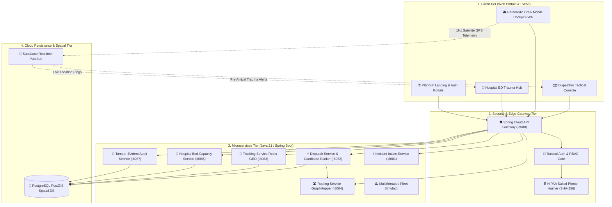

# Emergency Medical Services (EMS) Cloud Orchestration Platform
> **Next-Generation Autonomous Citywide Triage, Real-Time Satellite GIS Fleet Tracking & Hospital Emergency Capacity Management**

[](https://www.oracle.com/java/)
[](https://spring.io/projects/spring-boot)
[](https://www.postgresql.org/)
[](https://postgis.net/)
[](https://leafletjs.com/)
[](https://www.graphhopper.com/)
[](https://supabase.com/)
[](https://web.dev/progressive-web-apps/)
[](https://en.wikipedia.org/wiki/Role-based_access_control)

---

## 👨‍💻 Project Developer & Academic Details

> **Author & Lead Architect**: **Niraj Mandal**  
> **RTU Roll Number**: `24EARIT036`  
> **College / Institute**: Arya College of Engineering and Information Technology (ACEIT), Kukas, Jaipur  
> **Affiliation**: Rajasthan Technical University (RTU), Kota  
> **Branch**: Information Technology (IT)  
> **Batch**: 2024–2028  
> **Project Category**: Major Capstone Engineering Project  
> **Project Guide / Mentor**: **Er Ram Babu Buri** (Associate Professor, Department of Information Technology)  
> **Project Title**: Emergency Medical Services (EMS) Cloud Orchestration Platform  
> **GitHub Repository**: [nirajmandal1/EMS-Ambulance-System](https://github.com/nirajmandal1/EMS-Ambulance-System)

---

## 📖 Project Overview

In metropolitan emergency healthcare, every second delay increases patient mortality by up to 7%. Traditional emergency management systems suffer from three critical bottlenecks:
1. **Radio Communication Delays**: Dispatchers verbally query ambulance locations over radio, introducing minutes of human friction.
2. **Euclidean Routing Flaws**: Nearest ambulances are often assigned using straight-line distance ("as the crow flies"), ignoring city rivers, one-way streets, traffic congestion, and medical capability fit (ALS vs BLS).
3. **Ambulance Ramping**: Ambulances arrive unannounced at overcrowded hospital emergency rooms, forcing paramedics to wait outside for hours with critical patients because resuscitation bays are occupied.

The **EMS Platform** is a unified, high-speed cloud orchestration system engineered to solve these challenges. It synchronizes 911 emergency call dispatchers, frontline ambulance crews streaming live satellite GPS telemetry, and hospital trauma resuscitation bays on a single sub-second cloud network.

---

## ✨ Key Features & Capabilities

- **Autonomous Multi-Factor Candidate Ranking**: Prioritizes emergency vehicles using a weighted scoring function balancing ETA ($0.50$), vehicle medical equipment/crew certification fit ($0.30$), and receiving hospital bed capacity ($0.20$).
- **Sub-10ms PostGIS Spatial Search**: High-performance GiST spatial indexing on geographic coordinates (`GEOMETRY(Point, 4326)`) filtering units within proximity radius in milliseconds.
- **Turn-by-Turn Road Routing**: Real-world road graph calculation powered by GraphHopper and OpenStreetMap data.
- **High-Frequency 1Hz Telemetry Streaming**: Sub-second GPS geolocation broadcasting over WebSockets.
- **Dynamic Hospital Diversion & Anti-Ramping**: Real-time hospital trauma bay management system automatically rerouting incoming transports if ICU/resuscitation bays reach maximum saturation.
- **HIPAA & GDPR Compliant Privacy**: Salted SHA-256 phone number hashing masking caller identities into secure tokens (`CALLER-#F48A`).
- **Tactical Siren & Audio Alerting**: Built-in Web Audio API siren synthesizer providing immediate acoustic and visual cues to frontline crews.

---

## 🏛️ System Architecture

The platform is designed following an event-driven, 4-tier distributed microservices architecture:

1. **Client Tier**: Responsive web applications tailored for specific operational roles (GIS map console for dispatchers, mobile touch PWA for paramedics, trauma dashboard for hospital staff).
2. **Security & Edge Gateway Tier**: Spring Cloud Gateway validating cryptographic Bearer session tokens (`ems-auth-token-...`) and enforcing a 4-tier Role-Based Access Control (RBAC) matrix (`ADMIN`, `DISPATCHER`, `CREW`, `HOSPITAL_STAFF`).
3. **Business Microservices Tier (Java 21 / Spring Boot 3.3.4)**:
   - `api-gateway` (Port `8080`): Central routing, load balancing, and security boundary.
   - `incident-service` (Port `8081`): 911 call intake, caller privacy hashing, and MPDS triage classification.
   - `dispatch-service` (Port `8082`): Autonomous candidate scoring, fleet assignment, and lifecycle management.
   - `tracking-service` (Port `8083`): 1Hz GPS telemetry ingestion with Redis GEO spatial caching.
   - `routing-service` (Port `8084`): Road network turn-by-turn routing and dynamic travel matrix generation via GraphHopper.
   - `hospital-service` (Port `8085`): Resuscitation bay monitoring, diversion triggers, and pre-arrival alerts.
   - `redeployment-service` (Port `8086`): Predictive fleet repositioning across metropolitan zones.
   - `audit-service` (Port `8087`): Immutable SHA-256 audit ledger tracking every dispatch and override event.
   - `simulator`: Multithreaded Java fleet telemetry simulator animating vehicles across the metropolitan grid.
4. **Cloud Persistence & Spatial Tier**: PostgreSQL database enhanced with the **PostGIS** spatial extension for geographic operations and Supabase Realtime pub/sub channels.

---

## 📊 System Architecture Diagram



---

## 🚀 Flagship Operating Hubs

| Hub | Target User | Technologies | Key Features |
| :--- | :--- | :--- | :--- |
| **🗺️ Tactical Dispatcher Center** (`web/dispatcher/`) | 911 Dispatchers & Command Supervisors | Leaflet.js, GraphHopper OSM, WebSockets | Citywide GIS map tracking 14 ambulances, MPDS intake modal, candidate ranking leaderboard, green-wave activation. |
| **🚑 Paramedic Crew Mobile Cockpit** (`web/crew/`) | Frontline Ambulance Paramedics | Touch PWA, HTML5 Geolocation, Web Audio | Mobile ergonomics, audio siren alerts, live 1Hz GPS coordinate broadcasting, tactile 5-stage mission stepper. |
| **🏥 Hospital ED Trauma Hub** (`web/ed/`) | Emergency Department Physicians & Nurses | CSS3 Glassmorphism, Supabase Pub/Sub | Live resuscitation bay status monitors (Red, Yellow, Green), inbound ambulance ETA countdowns, dynamic hospital diversion controls. |
| **🌐 Platform Landing Portal** (`web/index.html`) | All Roles & System Administrators | HTML5, CSS3, Vanilla JS, Demo Bridge | Central unified launchpad with mock authentication presets, live system metrics, and quick access links. |

---

## ⚙️ Lifecycle Workflow

```
[ 911 Call Intake ] ──> [ Salted Phone Hash ] ──> [ PostGIS Radius Filter ]
                                                            │
                                                            ▼
[ Green-Wave Corridor ] <── [ Best Unit Assigned ] <── [ Multi-Factor Ranking ]
          │
          ▼
[ 1Hz GPS Streaming ] ──> [ 5-Stage Mission Stepper ] ──> [ Hospital Bay Handover ]
```

1. **Incident Intake & Privacy Hashing**: The dispatcher receives an emergency call and inputs incident severity and location. The phone number is hashed with SHA-256 (`CALLER-#F48A`).
2. **PostGIS Spatial Search**: `ST_DWithin` filters candidate ambulances within proximity in $< 10\text{ ms}$.
3. **Multi-Factor Ranking Engine**: Computes candidate score balancing ETA, medical capability fit (ALS vs BLS), and hospital trauma bay capacity.
4. **Unit Assignment & Green-Wave Corridors**: Top unit is dispatched with 1 click; critical emergencies trigger green-wave corridor visualization.
5. **Paramedic Mission Stepper**: The crew receives siren audio alerts and advances through:
   $$\text{Stage 1: Dispatched} \longrightarrow \text{Stage 2: En Route} \longrightarrow \text{Stage 3: At Scene} \longrightarrow \text{Stage 4: Transporting} \longrightarrow \text{Stage 5: Handover}$$
6. **Anti-Ramping Bay Handover**: Inbound vitals and ETA countdowns are streamed to the ED trauma hub for pre-arrival resuscitation bay preparation.

---

## 🛠️ Technology Stack

- **Backend**: Java 21 LTS, Spring Boot 3.3.4, Spring Cloud Gateway, Maven Multi-Module
- **Database & Spatial**: PostgreSQL 15+, PostGIS Spatial Extension, GiST Spatial Indexes, Supabase Realtime
- **Routing Engine**: GraphHopper 9.1 with OpenStreetMap (OSM) Road Network
- **Caching & Streaming**: Redis GEO, WebSockets, Kafka
- **Frontend & PWA**: Vanilla HTML5/CSS3 (Glassmorphism), Leaflet.js GIS, Web Audio API, Service Workers
- **Security**: Role-Based Access Control (RBAC), SHA-256 Salted Hashing, Bearer Session Authentication

---

## 💻 How to Run the Platform Locally

### Option 1: Unified Web & API Proxy Server (Recommended)
Run the automated deployment script:
```cmd
run_project.bat
```
Or start the Python web server directly:
```cmd
python server.py
```
Open your browser at:
- **Platform Landing**: [http://localhost:8088/](http://localhost:8088/)
- **Dispatcher Console**: [http://localhost:8088/dispatcher/](http://localhost:8088/dispatcher/)
- **Paramedic Cockpit**: [http://localhost:8088/crew/](http://localhost:8088/crew/)
- **Hospital ED Trauma Hub**: [http://localhost:8088/ed/](http://localhost:8088/ed/)

#### Default Demo Credentials:
| Role | Username | Password |
| :--- | :--- | :--- |
| **Tactical Admin** | `admin` | `admin123` |
| **Senior Dispatcher** | `dispatcher1` | `disp123` |
| **Paramedic ALS Unit** | `amb-01` | `crew123` |
| **Paramedic BLS Unit** | `amb-02` | `crew123` |
| **Hospital ED Staff** | `nurse1` | `ed123` |

---

### Option 2: Java Spring Boot Microservices
Compile all modules using Maven:
```cmd
mvn clean install -DskipTests
```
Launch all backend microservices simultaneously:
```cmd
start_backend.bat
```
Or run individual microservices:
```cmd
cd api-gateway && mvn spring-boot:run
cd incident-service && mvn spring-boot:run
cd dispatch-service && mvn spring-boot:run
cd hospital-service && mvn spring-boot:run
```

---

## 📁 Repository Directory Structure

```
Ems-platform/
├── pom.xml                     # Maven parent POM (Spring Boot 3.3.4, Java 21)
├── run_project.bat             # 1-Click platform launch script
├── start_backend.bat           # 1-Click microservices launcher
├── server.py                   # Unified development & proxy server
├── docker-compose.yml          # PostgreSQL, Redis, Kafka, Keycloak stack
├── supabase-schema.sql         # PostGIS spatial database schema
│
├── api-gateway/                # Spring Cloud API Gateway (Port 8080)
├── incident-service/           # 911 Call Intake & Triage (Port 8081)
├── dispatch-service/           # Capability-Aware Dispatch Engine (Port 8082)
├── tracking-service/           # 1Hz GPS Telemetry Ingestion (Port 8083)
├── routing-service/            # GraphHopper Road Network Engine (Port 8084)
├── hospital-service/           # Resuscitation Bay & Diversion Service (Port 8085)
├── redeployment-service/       # Predictive Fleet Repositioning (Port 8086)
├── audit-service/              # Tamper-Evident SHA-256 Audit Log (Port 8087)
├── simulator/                  # Multithreaded Fleet Telemetry Simulator
├── common/                     # Shared models and utilities
├── contracts/                  # Inter-service DTOs and event schemas
│
├── web/                        # Flagship Operational Frontends
│   ├── index.html              # Unified Landing Showcase Page
│   ├── demo-bridge.js          # Cross-hub synchronized event bus
│   ├── dispatcher/             # Tactical Dispatcher GIS Console
│   ├── crew/                   # Paramedic Mobile PWA Cockpit
│   └── ed/                     # Hospital ED Trauma Bay Hub
│
└── Project_Documents/          # Official Academic Documents & Reports
    ├── EMS_Project_Report.pdf  # Comprehensive Project Technical Report
    ├── EMS_SRS.pdf             # Software Requirements Specification
    └── EMS_Research_Paper.pdf  # Academic Research Study
```

---

## 📑 Academic Documentation & Links

- **Source Code**: [https://github.com/nirajmandal1/EMS-Ambulance-System](https://github.com/nirajmandal1/EMS-Ambulance-System)
- **Project Report**: [Project_Documents/EMS_Project_Report.pdf](Project_Documents/EMS_Project_Report.pdf)
- **SRS Document**: [Project_Documents/EMS_SRS.pdf](Project_Documents/EMS_SRS.pdf)
- **Research Paper**: [Project_Documents/EMS_Research_Paper.pdf](Project_Documents/EMS_Research_Paper.pdf)

---

## 📜 License & Copyright

Developed by **Niraj Mandal** (`24EARIT036`) for the Major Capstone Engineering Project at **Arya College of Engineering and Information Technology (ACEIT)**, affiliated with **Rajasthan Technical University (RTU)**.
